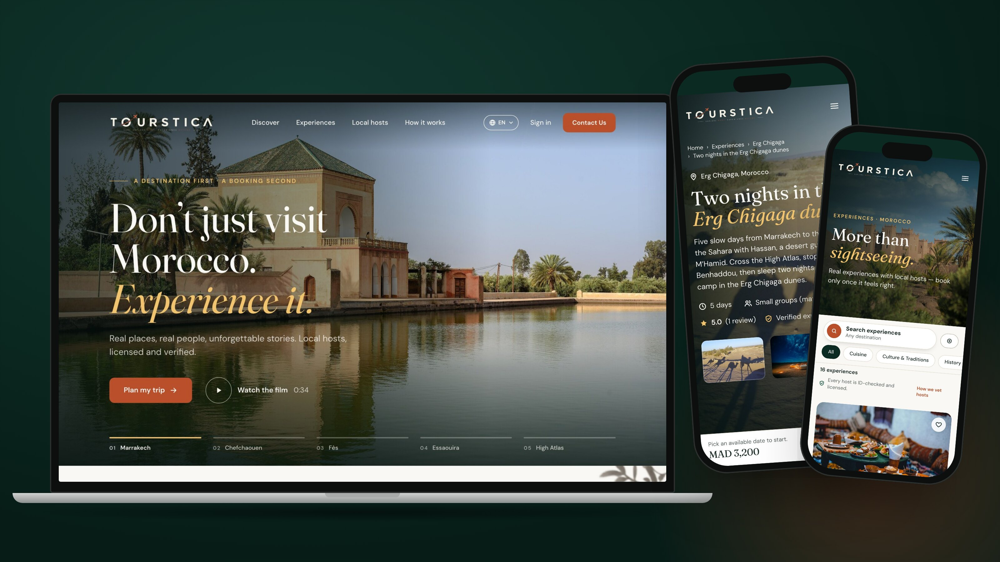
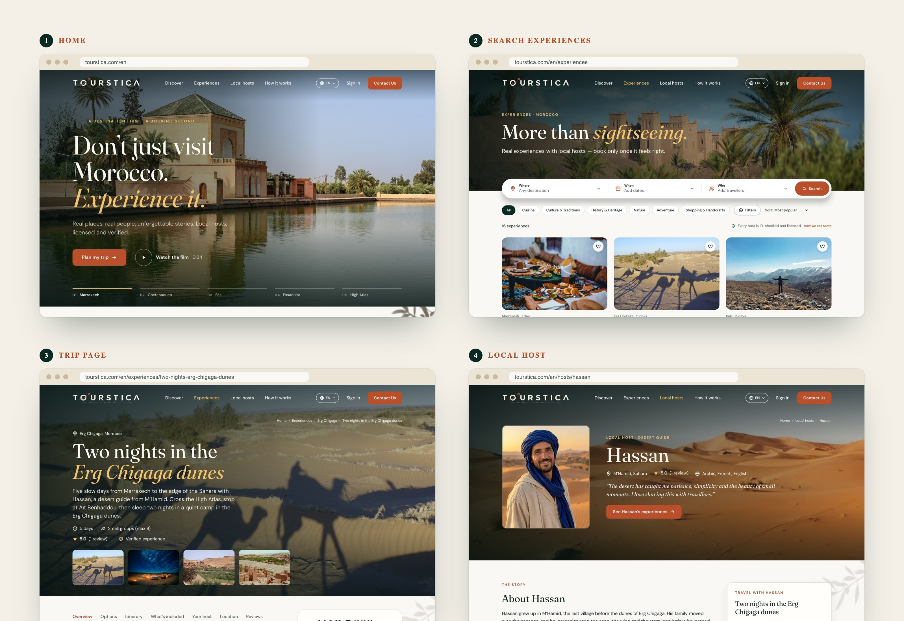
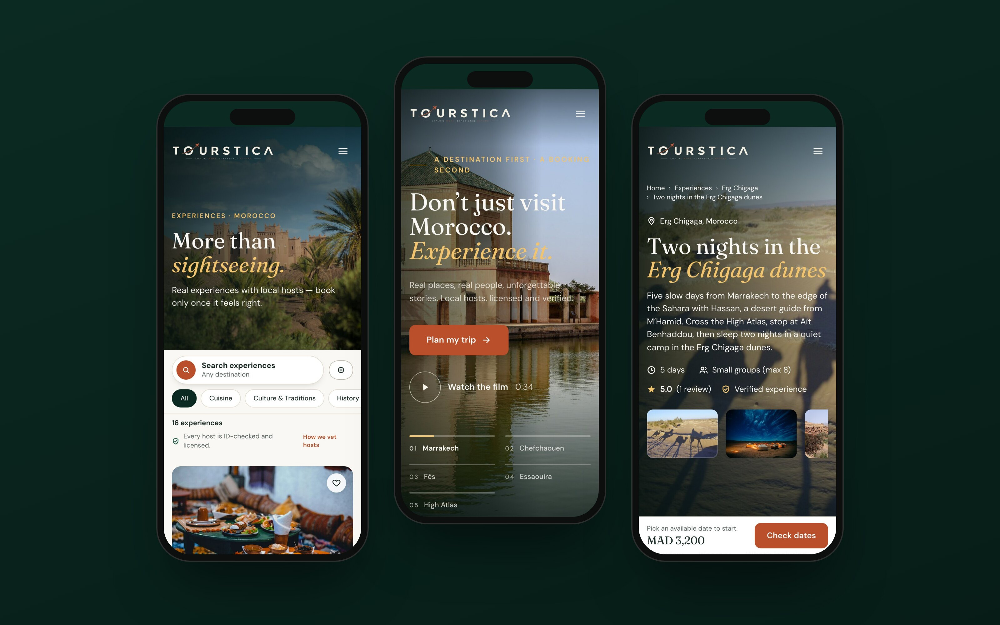

<div align="center">

# Tourstica

**A booking marketplace for Morocco: local agencies list trips, travellers book them in a few taps.**

Laravel 13 · PHP 8.3 · Blade + Alpine.js · Tailwind · MySQL 8 · English / French / Dutch



</div>

## What it is

Travellers who have never been to Morocco don't know which guide to trust or what a fair price is. Tourstica puts vetted local agencies and their trips (desert nights, food walks, Atlas hikes) in one place, with clear prices, real availability and reviews from people who actually went.

The platform has three sides:

| Area | Who | What they do |
|------|-----|--------------|
| **Public site** `/{locale}/…` | Travellers | Browse destinations, interests and hosts; get a live quote; book; manage trips; leave reviews; keep a wishlist |
| **Agency dashboard** `/agency/…` | Travel agencies | Register and wait for approval; manage experiences, options, time slots, hosts, bookings, payouts and reviews |
| **Admin panel** `/admin/…` | Platform team | Approve agencies and listing changes; edit site content with drafts and revisions; oversee bookings, payouts and commission |

## In numbers

| | |
|---|---|
| **216** PHPUnit tests · **1,156** assertions · all passing in **~8.4 s** | **7** JS tests for the booking widget (`node --test`) |
| **204** routes across 3 areas (public, agency, admin) | **12** business domains under `app/Domain` |
| **43** single-purpose Actions · **33** Form Requests · **53** controllers | **41** Eloquent models · **39** migrations · **12** seeders |
| **8** domain events (booking confirmed, cancelled, completed, review submitted…) | **13** code paths that take row locks (`lockForUpdate`) |
| **3** languages with **~1,980** UI strings each (en, fr, nl) | **371** Blade views and components |
| **~14,900** lines of application PHP · **~5,300** lines of tests | **0** frontend frameworks: server-rendered Blade + Alpine.js |

## How the booking logic works



**1. No overselling, even under concurrent checkouts.**
Seats are reserved inside a database transaction that locks the time-slot row (`SELECT … FOR UPDATE`, 5 s lock timeout). Two people racing for the last seat are served one after the other; the second one sees the slot as full. Availability is never cached.

**2. Checkout holds that expire on their own.**
Starting checkout holds the seats for 30 minutes (`reserved_until`). A scheduled command runs every 5 minutes and releases abandoned holds, so a closed tab never blocks a slot for real customers.

**3. Instant confirmation.**
An available slot becomes a `confirmed` booking at checkout, without waiting for anyone to approve it. A scheduled command runs every hour and marks trips `completed` once their date has passed. Payment status is tracked separately from booking status.

**4. Group vs private pricing.**
Group: `price_per_person × participants`, sharing the slot with others. Private: one flat `private_price` that takes every seat of the slot. Private is hidden when the agency hasn't set a price.

**5. Prices are frozen at booking time.**
A booking stores the package, host, time, cancellation policy, commission and payout amounts as they were at checkout. If the agency later changes its prices, past bookings don't move. All money math uses `brick/money` (no floats) on `decimal(10,2)` columns.

**6. Payouts follow confirmation.**
Confirming a booking creates the agency payout after the transaction commits (default commission 15%, allowed range 0–50%). The platform's own agency never gets a payout. An admin marks payouts paid after the bank transfer.

**7. Cancellations and refunds by rule.**
Admin cancellation means a full refund. A traveller cancellation uses the experience's policy: hours before departure and a refund percentage. Departure times are read in Morocco time (`Africa/Casablanca`), whatever the server's time zone.

**8. Moderated publishing.**
New listings, and edits to listings that are already live, go into a change request. The approved version stays public while the new one waits for an admin. Drafts can be previewed but never booked (covered by a JS test).

**9. Slot safety.**
A slot with bookings or active checkout holds can't be moved or deleted, and its capacity can't go down. Private bookings stay exclusive when capacity goes up.

**10. Reviews from real travellers only.**
A review is possible only after the trip is `completed`, and only one per booking.

## Design



The interface was designed in Figma first, then built screen by screen in Blade components with design tokens (`resources/css/site-v2/tokens.css`): a forest green and terracotta palette, Fraunces for display type, DM Sans for text. Built for phones first. Screenshots are taken from the running app; the full home page is in [docs/screenshots/home-full.jpg](docs/screenshots/home-full.jpg).

Other parts of the build:

- **Search and filters** with a sticky bar, custom date calendar and "Where / Who" menus that become full-screen sheets on phones.
- **Maps** with Leaflet: route map on the trip page, pick-up point picker in checkout and in the agency form.
- **Visual content editor** for admins: edit the home page on the live page, with localized drafts, a protected preview and revision history.
- **SEO**: localized URLs (`/en`, `/fr`, `/nl`), managed meta tags and structured data, sitemap.
- **Security**: role permissions (Spatie Permission), policies, a Content Security Policy (Spatie CSP), and Blade output always escaped.

## Architecture

```
Controller → Form Request → Action → Service → Model → DTO → ViewModel → Blade component
```

- **Controllers** stay under 10 lines per method: validate with a Form Request, run one Action, return a view.
- **Actions** are `final` classes with a single `execute()`, one use case each, and fire events when state changes.
- **Services** hold logic shared by several Actions (seat reservation, availability changes, drafts).
- **Blade** never runs queries; ViewModels prepare everything the view needs.

```
app/
  Domain/          Agency, Booking, Checkout, Discover, Experience, Landing,
                   Payment, Payout, Review, User, Wishlist, Shared
                   (models, actions, services, events and view models per domain)
  Http/Controllers/Admin | Agency | Auth | Site
routes/            site.php · agency.php · admin.php · auth.php · web.php
docs/              architecture, booking flow, frontend contracts, SEO, deploy runbook
```

## Stack

| Layer | Choice |
|-------|--------|
| Backend | PHP 8.3, Laravel 13, Breeze auth |
| Frontend | Blade, Tailwind CSS, Alpine.js, GSAP, Lenis, Leaflet, Vite |
| Data | MySQL 8 in production, SQLite for local work and tests, Redis + Horizon for queues |
| Search | Laravel Scout + Meilisearch |
| Packages | Spatie: permission, media-library, translatable, model-states, data, settings, sitemap, sluggable, activitylog, csp · Laravel Pennant |
| Money | `brick/money`, currency MAD |
| Quality | PHPUnit, Larastan, Pint |

## Run it locally

Requirements: PHP 8.3+, Composer, Node 20+, and SQLite or MySQL.

```bash
composer setup          # install, copy .env, key:generate, migrate, npm install, build
php artisan db:seed     # roles, admin, demo agency, landing content, demo experiences
composer dev            # server + queue + logs + Vite together
```

Open http://localhost:8000 (it redirects to `/en`).

The seeders create accounts from the `ADMIN_*` and `DEMO_*` values in `.env`, so set those first. Don't run the demo seeders against a production database.

| Key | Purpose |
|-----|---------|
| `ADMIN_NAME`, `ADMIN_EMAIL`, `ADMIN_PASSWORD` | First admin account |
| `DEMO_ADMIN_*`, `DEMO_AGENCY_*`, `DEMO_CLIENT_*` | Demo logins created by the seeders |
| `DEFAULT_COMMISSION_RATE` | Platform commission (%) |
| `APP_DEFAULT_CURRENCY` | Defaults to `MAD` |

## Tests

```bash
composer test            # PHPUnit feature + unit tests
npm run test:booking     # booking widget tests (node --test)
./vendor/bin/phpstan     # static analysis (Larastan)
./vendor/bin/pint        # code style
```

## Deployment

Deployed to shared hosting without Node, so assets are built locally and uploaded. The steps are in [docs/DEPLOY.md](docs/DEPLOY.md).

## Roadmap

- Online payment (the gateway layer is an interface today; Stripe / PayPal / CMI come in a later phase)
- Agency verification badges and quality scores

## More documentation

- [docs/ARCHITECTURE.md](docs/ARCHITECTURE.md): schema, business rules, roles
- [docs/MARKETPLACE_FLOW_PLAN.md](docs/MARKETPLACE_FLOW_PLAN.md): booking and checkout flow
- [docs/ADMIN_DASHBOARD.md](docs/ADMIN_DASHBOARD.md): admin features
- [docs/SEO.md](docs/SEO.md): SEO rules for public pages
